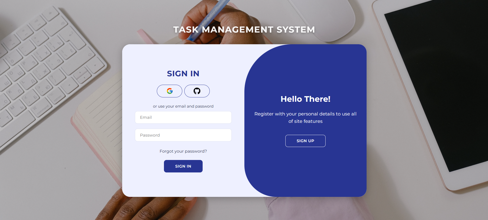
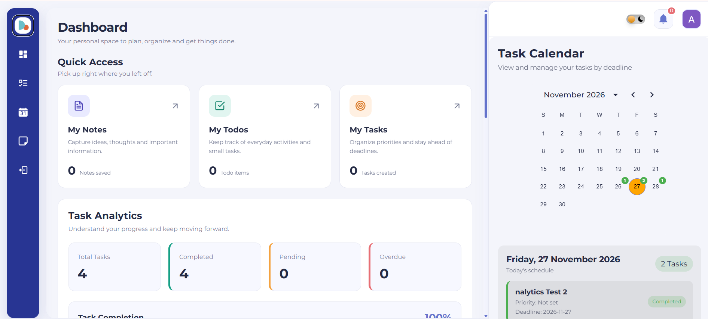
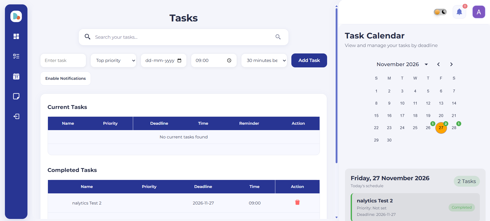
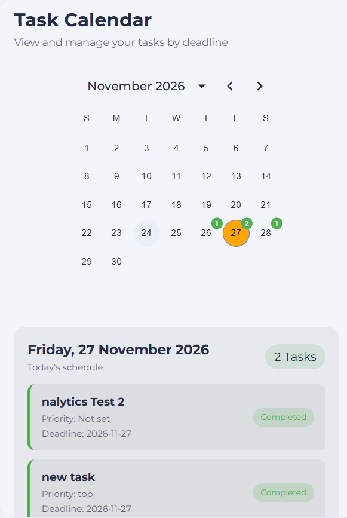
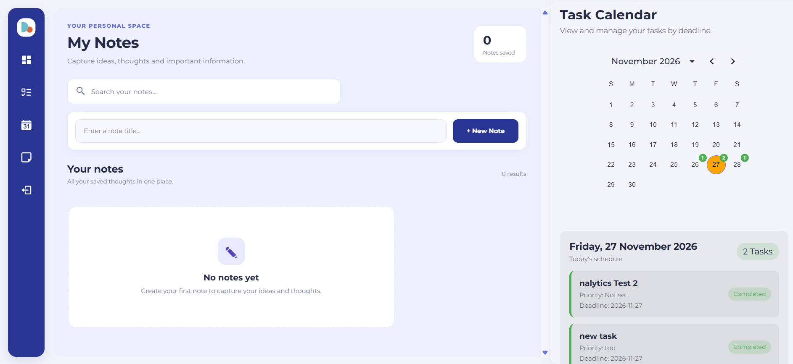
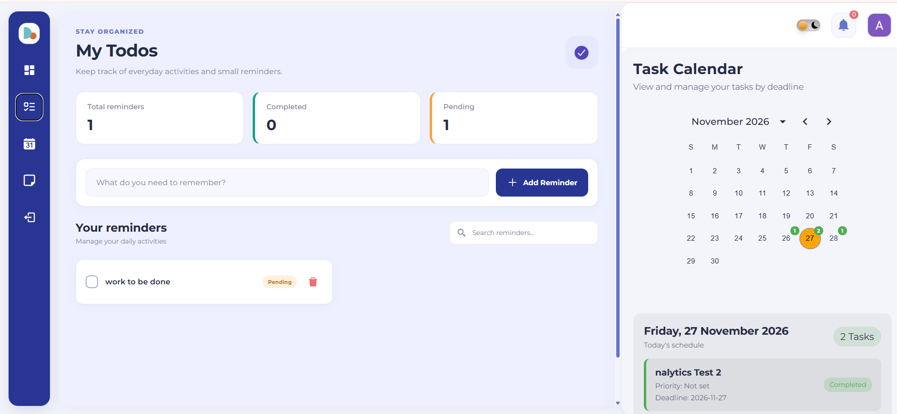
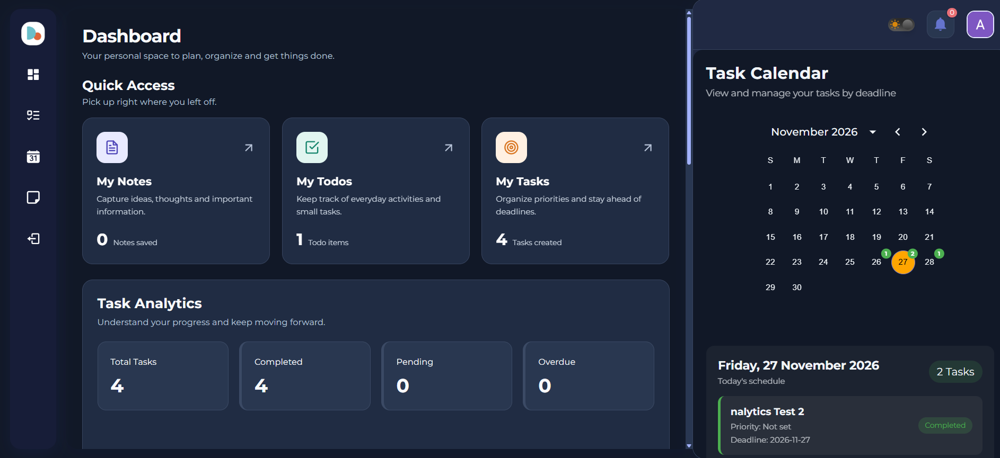

# Task Management System – MERN Stack

A modern, full-stack productivity application built using the MERN stack (MongoDB, Express.js, React.js, and Node.js). The application helps users organize daily activities, manage tasks, create reminders, and maintain personal notes through an intuitive and responsive user interface.

## Introduction

The Task Management System provides a centralized platform for managing everyday activities and improving personal productivity.

Users can create tasks with priorities and deadlines, maintain to-do lists, save important notes, and track their progress through an interactive dashboard. The application also includes calendar integration, deadline reminders, authentication, productivity analytics, and light and dark themes.

## Features

### 1. User Authentication
- User registration and login.
- Secure password hashing using bcrypt.
- Google OAuth authentication.
- GitHub OAuth authentication.
- Session-based authentication using Passport.js.
- Forgot password and password reset functionality.
- Protected application routes.

### 2. Dashboard
- Personalized dashboard with quick access to Notes, Todos, and Tasks.
- Overview of task progress and productivity.
- Task completion and pending task statistics.
- Task status and priority analytics.
- Weekly productivity overview.
- Upcoming deadlines and task summaries.
- Productivity insights.

### 3. Task Management
- Create and delete tasks.
- Assign priorities to tasks.
- Set deadlines and specific times.
- Configure reminders before deadlines.
- Mark tasks as completed.
- Separate current and completed tasks.
- Search and manage tasks.

### 4. Task Calendar
- Interactive calendar for viewing scheduled tasks.
- Identify dates containing scheduled tasks.
- Select a date to view its associated tasks.
- View daily task schedules and deadlines.

### 5. Notifications and Reminders
- Browser notification support.
- Notifications for upcoming task deadlines.
- Configurable reminder intervals.
- Notification indicator and in-app notification panel.

*Note: Browser notifications require user permission. Reminder checks operate while the application is running.*

### 6. To-Do List
- Create and manage daily reminders.
- Mark reminders as completed.
- Delete unwanted reminders.
- Search and filter to-do items.
- Track completed and pending reminders.

### 7. Notes Management
- Create personal notes with titles.
- Add and edit note content.
- Save note changes to the database.
- Delete unwanted notes.
- Search notes by title.
- View note creation date and time.

### 8. User Interface and Themes
- Modern and responsive user interface.
- Redesigned dashboard and navigation.
- Light mode and dark mode.
- Consistent color palette and improved text contrast.
- Interactive hover effects and scroll animations.
- Scrollable pages for easier navigation.

---

## Technologies Used

### Frontend
- React.js
- JavaScript
- HTML5
- CSS3
- Axios
- React Router
- Material UI
- Recharts
- React Icons
- React Toastify
- AOS (Animate On Scroll)

### Backend
- Node.js
- Express.js
- Passport.js
- Passport Local Strategy
- Passport Google OAuth 2.0
- Passport GitHub OAuth
- bcrypt
- Express Session
- Nodemailer
- JSON Web Token (JWT)

### Database
- MongoDB
- Mongoose
- MongoDB Atlas

### Development Tools
- Visual Studio Code
- Git
- GitHub
- npm
- Postman

---

## Project Structure

```text
Task-Management-System/
│
├── BackEnd/
│   ├── Models/
│   ├── Routes/
│   ├── passport.js
│   ├── index.js
│   ├── package.json
│   └── .env
│
├── FrontEnd/
│   ├── public/
│   ├── src/
│   │   ├── components/
│   │   │   ├── styles/
│   │   │   └── ...
│   │   ├── App.js
│   │   ├── App.css
│   │   └── index.js
│   ├── package.json
│   └── .env
│
├── assets/
│   ├── login.png
│   ├── dashboard.png
│   ├── tasks.png
│   ├── calendar.png
│   ├── notes.png
│   ├── todos.png
│   └── dark-mode.png
│
├── README.md
└── .gitignore
```

*The structure provides a simplified overview of the project.*

---

## Getting Started

Follow these instructions to run the project locally.

### Prerequisites

Make sure you have installed:

- [Node.js](https://nodejs.org/) (v16 or higher)
- npm
- [MongoDB Atlas](https://www.mongodb.com/atlas) account or a local MongoDB instance
- [Git](https://git-scm.com/)
- [Visual Studio Code](https://code.visualstudio.com/)

Check the installed versions:

```bash
node --version
npm --version
```

### 1. Clone the Repository

```bash
git clone YOUR_GITHUB_REPOSITORY_URL
```

Navigate to the project directory:

```bash
cd Task-Management-System
```

### 2. Backend Setup

Navigate to the backend directory:

```bash
cd BackEnd
npm install
```

Create a `.env` file inside the `BackEnd` directory and configure the following variables:

```env
MONGO_URL=your_mongodb_connection_string

SESSION_SECRET=your_session_secret
JWT_SECRET_KEY=your_jwt_secret

FRONTEND_DOMAIN=http://localhost:3000

GOOGLE_CLIENT_ID=your_google_client_id
GOOGLE_CLIENT_SECRET=your_google_client_secret

GITHUB_CLIENT_ID=your_github_client_id
GITHUB_CLIENT_SECRET=your_github_client_secret

EMAIL_USER=your_email@gmail.com
EMAIL_PASS=your_gmail_app_password
```

Replace the placeholder values with your actual configuration.

Start the backend server:

```bash
npm start
```

Backend URL:

```text
http://localhost:8080
```

### 3. Frontend Setup

Open another terminal and navigate to the frontend directory:

```bash
cd FrontEnd
npm install
```

Create a `.env` file inside the `FrontEnd` directory:

```env
REACT_APP_API_URL=http://localhost:8080
```

Start the frontend:

```bash
npm start
```

Frontend URL:

```text
http://localhost:3000
```

The application should now be accessible through your browser.

---

## OAuth Configuration

To enable Google and GitHub authentication, create OAuth applications with the respective providers.

### Google OAuth

Create OAuth credentials through the [Google Cloud Console](https://console.cloud.google.com/).

Configure the development callback URL:

```text
http://localhost:8080/google/callback
```

### GitHub OAuth

Create an OAuth application through [GitHub Developer Settings](https://github.com/settings/developers).

Configure the callback URL:

```text
http://localhost:8080/github/callback
```

Add the corresponding client IDs and client secrets to the backend `.env` file.

---

## Database

MongoDB is used to store application data, including:

- User account information.
- Tasks and completion status.
- Task priorities and deadlines.
- Reminder configurations.
- To-do items.
- Personal notes.

Mongoose is used for database connectivity and schema management.

---

## Application Screenshots

The following screenshots showcase the user interface and key features of the Task Management System.

### Login and Registration



### Dashboard



### Task Management



### Task Calendar



### Notes



### To-Do List



### Dark Mode



---

## Future Enhancements

- Background push notifications.
- Advanced task filtering and sorting.
- Rich-text note editing.
- Task export and reporting.
- Enhanced mobile experience.
- Collaborative task management.

---

## Security

- Passwords are hashed before storage.
- Sensitive credentials are maintained through environment variables.
- Authentication middleware protects private application routes.
- OAuth credentials and database connection strings should never be committed to GitHub.
- Environment files should be excluded from version control.

---

**Task Management System – Organize Better. Plan Smarter. Get Things Done.**